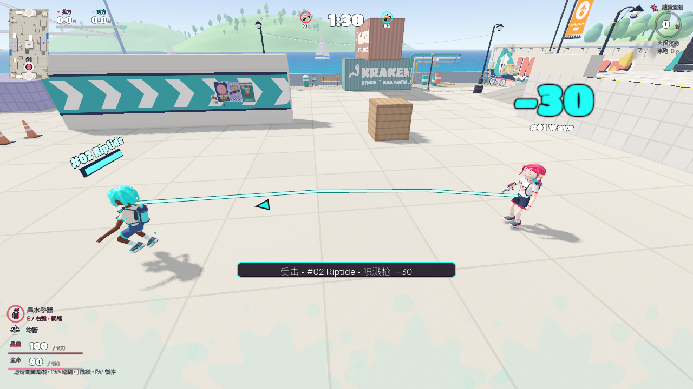
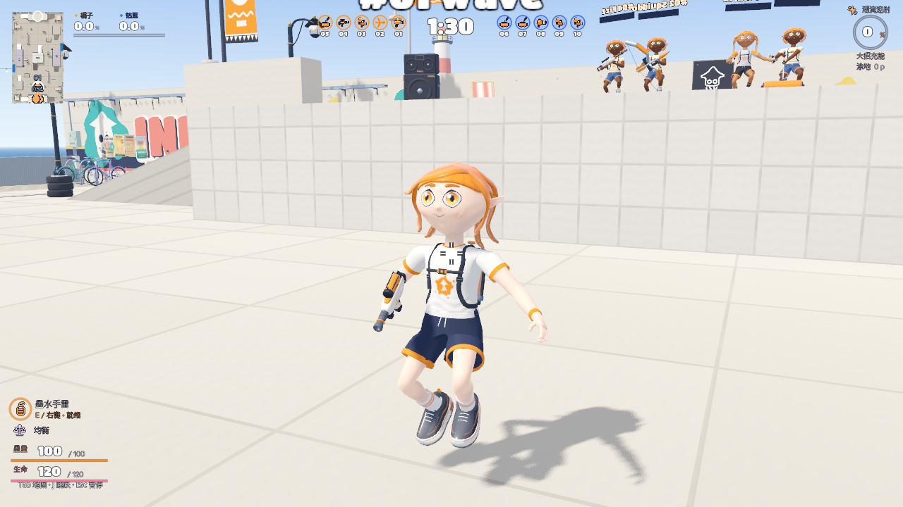

# 战斗体验验收 · 2026-10-05

本轮完成高台 AI 停顿、可选难度／护盾、整体墨耗／敌方墨地、八种专属大招和死亡进度继承、攻击来源与轨迹、角色／场景／墨面渲染。参数和玩法见 [EXPERIENCE_TUNING.md](../../docs/EXPERIENCE_TUNING.md)。仅本地提交，无推送、Release、应用导出或压缩包。

## 无界面规则

`./tools/run_checks.sh`：95 项全部通过（解析门 → 269 本地资产 → 规则／场景检查），见 [完整输出](checks.txt)。资产门的有效、损坏、缺失、未申报新增、导入元数据排除及空清单六项隔离用例通过，见 [输出](asset-negative.txt)。菜单检查的既有夹具在退出时仍报告 4 个 ObjectDB 实例泄漏；该警告不属于通过门的脚本错误，当前原生对局／新专项未出现同类退出警告。

新增专项覆盖：真实视线／碰撞下高台横移；三档选择与整局锁定、菜单快捷键隔离；八武器均衡／节墨实际扣墨、充能停回墨；60 护盾吸收和跨死亡冷却；八专属大招、死亡／换装比例继承、两队机器人实际施放、无友伤／不穿墙；压力炮计入易伤后同目标共享最终 150 上限；真实弹道在墙面截止、命名来源、护盾后掉血、冻结来源、方向随镜头、环境不伪造方向、蓄狙预瞄与真实引信预警。

四个有意新增本地 SVG 图标经过 64×64／实际绘制元素语义检查和原生显示，再显式更新资产清单。CPU 墨格源码未改，视觉不写归属／计分账本。

## 机器人停顿定位

位置 → 原因 → 修复 → 验证：`src/actors/tidewater_bot.gd` → 原射程内交战分支停止沿路线移动，已看见高台玩家仍会原地瞄准 → 安全横移射击、受阻侧移重规划、可达巡逻兜底 → [修改前复现](high-ground-before.txt) 显示目标已取得但 2.5 秒移动 0m；最终实际视野／碰撞／射击的三档原生受控记录分别移动约 0.97／2.00／3.05m。

三档首发反应分别为第 16／7／3 物理帧，12／17／18 发；这些是固定位置夹具结果，不代表全地图无人停顿。蓄力、等待补给和出场跳跃仍允许合法短暂停顿。

## 原生输入与画面

Godot 4.8.dev6，arm64 / Metal 4.0 / Forward+ / Apple M5。

- [原生输入报告](controls-completed/report.json)：960×540 / 110% 鼠标点选真实护盾；E 启动，82 伤害被 60 护盾吸收后仅掉 22；三档高台 AI 实际移动射击；八武器均以真实 F 消耗进度激活各自大招。大招进度由夹具发满以验证激活／画面，不能证明充能节奏。AI 配装选择通过真实 GUI 选择信号配置，系统弹出菜单的鼠标／键盘操作不作为已验收证据。
- [攻击反馈报告](readability-accepted/report.json)：真实敌方弹丸的扫掠长度、真实命中后姓名／武器／方向、机器人狙击蓄力预瞄、实际炸弹落地引信预警。固定位置和镜头，非真人对局。
- [渲染报告](render-accepted/report.json)：固定外观种子 731、队色／人物姿态／镜头／墨地和 1280×720；对比 [修改前人物](before-render-clean/character.png)、[最终人物](render-accepted/character.png)，[修改前墨面](before-render-clean/ink.png)、[最终墨面](render-accepted/ink.png)，[最终场景](render-accepted/arena.png)。此前被暂停面板／GO 遮挡或菜单注入失败的试拍已移除；截图夹具明确关闭失焦暂停遮挡，生产失焦暂停不改。

## 180 秒自然对局与帧间隔

[完整报告](native-match/match.json)：1280×720、100% 渲染、30 FPS 上限、潮水码头 5v5、实际自动键鼠输入与生产机器人。180.07 秒自然游戏时间，玩家自然阵亡／显式确认并完成复活各 9 次；自然 finish → results → home、十人战绩、个人到队伍面积、CPU 覆盖率与结算一致。无失焦恢复干预。

除前 5 秒预热，5240 个帧样本：均值 29.93 FPS，P50 33.36ms、P95 35.66ms、P99 41.63ms；超过 50ms 的帧 5 个，最大 376.50ms。记录包含截图、30 FPS 限制与桌面调度，不能据此承诺所有机器／地图稳定帧率，也不能当作相比旧渲染的性能提升量。

自然对局发生在最终飞镖／双持／墨弓帮助文案数值及百分号格式化同步之前，报告保留当时的完整源码哈希；其后仅 `src/ui/loadout_details.gd` 的说明文本改变，玩法／渲染没有改变。最终规则检查与三项原生受控报告绑定同步后的源码。

## 未验证边界

真人完整对局、八武器主观平衡／手感、角色和场景审美接受、全地图长时 AI／性能／温度、联网和本批实际导出仍未验收。已有 preview.16 应用不包含本批源码。图像证明实际渲染结果，不能替用户认可外观。

[验收收据](acceptance.json) 校对最终三项原生报告的全部源码哈希、画面字节及当前捕获工具，均匹配最终源码；自然对局报告只允许已注明的帮助文案差异。
